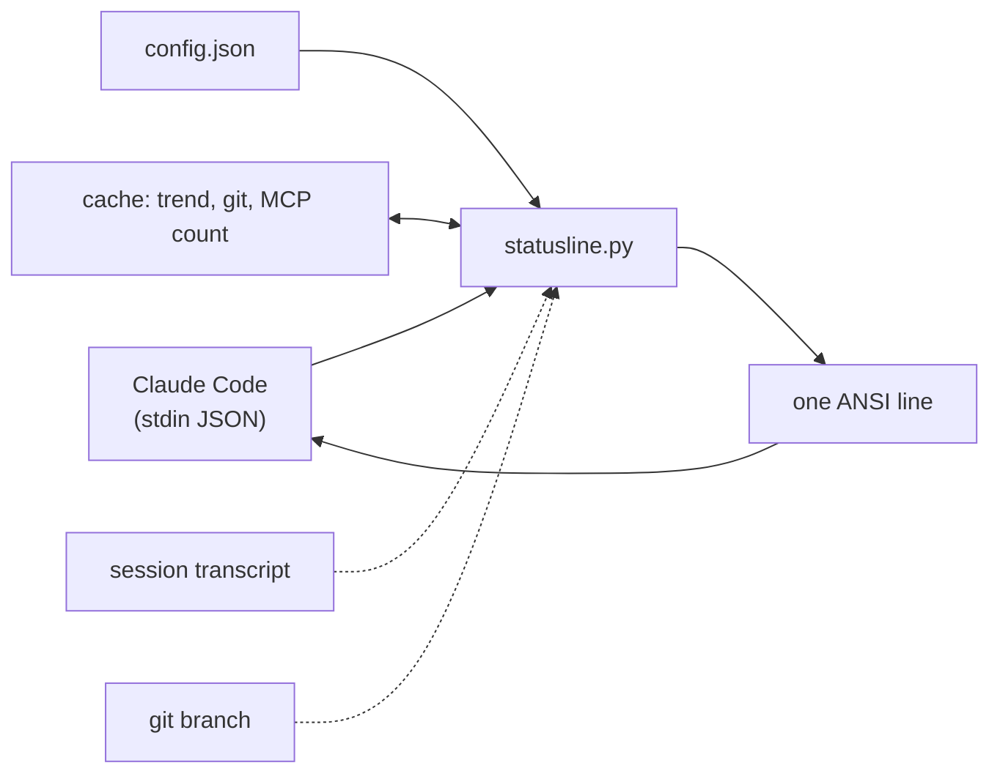

<p align="center">
  
</p>

<h1 align="center">claude-statusline</h1>
<p align="center"><b>Know how much Claude Code you have left before it runs out.</b><br>
A fast, zero-dependency status line: context bar, 5-hour and weekly limits, burn-rate warning, session cost, git, uptime.</p>

<p align="center">
  
  
  
  
  
</p>

<p align="center">
  <a href="#quick-start">Quick start</a> ·
  <a href="#features">Features</a> ·
  <a href="#how-it-works">How it works</a> ·
  <a href="#configuration">Configuration</a> ·
  <a href="README.ru.md">Русский</a>
</p>

---

```text
[Opus 5.5] | ━━━━━━━━━━ 12% (120K/1000K) | H:91% 4h21m | W:73% | ⚙M+t | session $2.84 | my-app | ⏱ 1h 12m
 model       context bar                    5h left+reset  week    mode   cost           dir      uptime
```

| State | What you see |
| --- | --- |
| 🟢 Plenty left | green bar, `H:91% 4h21m`, yellow cost |
| 🟡 Getting busy | `H:30%` turns yellow, the bar follows your **absolute** token load |
| 🔴 Running dry | `H:7% 2h10m 🔥14m`: at this pace the 5-hour window is gone in 14 minutes |

Open [`docs/demo.html`](docs/demo.html) for the real output of the script (colours included) in four variants: full, minimal, Russian, almost out of limit.

## Why

The built-in footer does not tell you that you are about to hit the 5-hour limit, or that 420K tokens in a 1M window is already expensive. This line does, at a glance, and it does it from the JSON that Claude Code already hands to every status line: no network, no tokens spent, one tiny Python process per render.

- **Absolute context colours.** 42% of a 1M window is 420K tokens: that is red, not "42%, fine".
- **Burn-rate projection.** Measures how fast the 5-hour limit drains and shows when it will hit zero, only when that is before the reset.
- **Yours to shape.** Every segment can be switched off, reordered, recoloured. English or Russian labels.

## Features

| | |
| --- | --- |
| 📊 **Context bar** | length = share of the window, colour = absolute tokens, `120K/1000K` |
| ⏳ **5-hour limit** | percent left and time to reset, colour-coded |
| 🔥 **Burn rate** | warns when the limit will run out before it resets |
| 📅 **Weekly limit** | percent left on the 7-day window |
| ⚙ **Mode** | effort `L/M/H/XH/MAX`, `+t` thinking, `+fast` |
| 💲 **Session cost** | hidden at $0, red from a threshold you choose |
| 🪙 **Session tokens** | optional: total and output tokens, sub-agents included |
| 🌿 **Git, dir, MCPs, uptime** | branch, project folder, MCP server count, session length |
| 🧩 **Configurable** | order, presets, colours, bar width, thresholds, labels, language |
| 🪶 **Light** | stdlib only, no network, cached git/MCP lookups, never crashes the line |

## Quick start

```bash
git clone https://github.com/meshoklv/claude-statusline.git
cd claude-statusline && ./install.sh
```

Restart Claude Code. That's it. Variants: `./install.sh --lang ru`, `./install.sh --preset minimal`. Undo with `./install.sh --uninstall` (restores your previous status line if you had one).

**Requirements:** Python 3.8+, bash, a terminal with UTF-8. Limits (`H:` / `W:`) appear for Claude Pro/Max subscribers after the first response; without them those segments simply hide.

<details>
<summary>Manual install</summary>

```bash
cp statusline.py ~/.claude/claude-statusline.py
```

Add to `~/.claude/settings.json`:

```json
{
  "statusLine": {
    "type": "command",
    "command": "python3 \"$HOME/.claude/claude-statusline.py\""
  }
}
```

Test it without Claude Code:

```bash
echo '{"model":{"display_name":"Opus"},"context_window":{"used_percentage":12,"context_window_size":1000000}}' | python3 statusline.py
```

</details>

> [!NOTE]
> The installer backs up `settings.json` first, refuses to replace a different status line unless you pass `--force`, and `--uninstall` puts it back.

## How it works



Claude Code runs the command on every update and pipes session data to it. The script builds each enabled segment, joins them with the separator, and prints one line. Burn rate uses real samples of your 5-hour usage appended to a small trend file (capped at 300 lines, only from the current window, needs 5 minutes of history). A broken segment is skipped, never fatal.

## Configuration

File: `~/.config/claude-statusline/config.json` (or `CLAUDE_STATUSLINE_CONFIG`). Everything is optional; see [`config.example.json`](config.example.json).

| Key | Default | Meaning |
| --- | --- | --- |
| `lang` | `"en"` | `en` or `ru` |
| `preset` | `"full"` | `full`, `minimal` (model, context, 5h), `compact` |
| `segments` | preset | explicit order, from: `model context five_hour weekly mode tokens cost dir git mcps uptime` |
| `separator` | `" \| "` | between segments |
| `bar` | width 10, `━` | `width`, `filled`, `empty` characters |
| `colors` | green / yellow / red / `#5a5a5a` | `ok warn crit dim`: name, `#rrggbb` or 0-255 |
| `labels` | `H` / `W` | text before the 5-hour and weekly percentages |
| `thresholds.context_red_tokens` | `300000` | bar is fully red from this token load |
| `thresholds.cost_red_usd` | `10` | session cost turns red |
| `thresholds.limit_warn_left` / `limit_crit_left` | `50` / `20` | % left where limits go yellow / red |
| `burn_projection` | `true` | show the 🔥 projection |

Environment: `CLAUDE_STATUSLINE_LANG`, `CLAUDE_STATUSLINE_PRESET`, `CLAUDE_STATUSLINE_STATE_DIR` (default `~/.cache/claude-statusline`), `CLAUDE_CONFIG_DIR`, `NO_COLOR`.

<details>
<summary>Tokens segment and other recipes</summary>

```json
{ "segments": ["model", "context", "five_hour", "tokens", "cost", "dir"], "colors": { "ok": "cyan" }, "bar": { "width": 20 } }
```

`tokens` reads the session transcript and its sub-agent transcripts, counts each streamed message once, and shows `🪙 1.2M tok · out 45K`. It is off by default because it reads files on every render (incrementally cached).

</details>

## FAQ

**Does it call any API?** No. Everything is stdin JSON plus local files.

**Why is `H:` a percentage *left*?** It answers "how much runway do I have", and green-to-red matches that.

**Tested on:** Linux, Python 3.8 and 3.12 in CI. **Not yet tested on:** macOS and Windows terminals (it should work on macOS; Windows is unsupported).

## Contributing

PRs are welcome, see [CONTRIBUTING.md](CONTRIBUTING.md). Run `python3 -m unittest discover -s tests -v`.

## License

[MIT](LICENSE)

Made by [@meshoklv](https://github.com/meshoklv)
