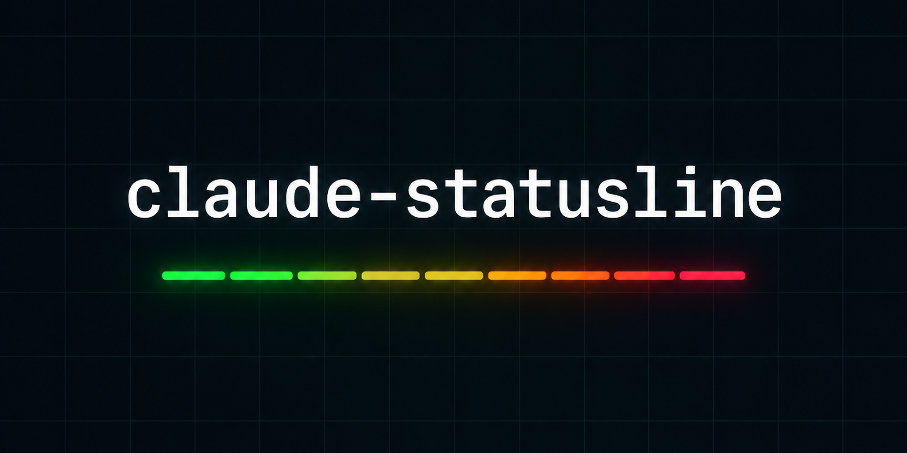
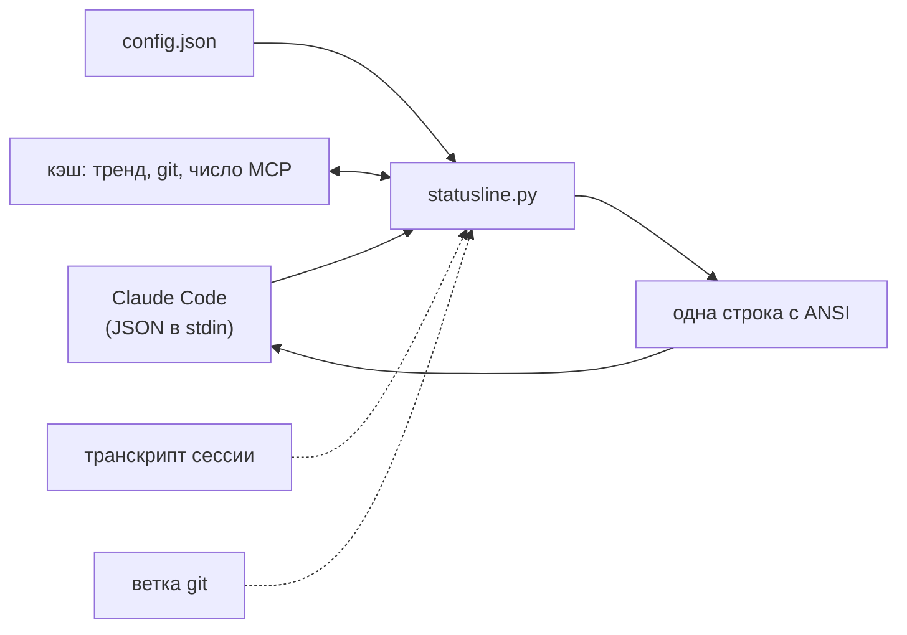

<p align="center">
  
</p>

<h1 align="center">claude-statusline</h1>
<p align="center"><b>Узнай, сколько Claude Code осталось, пока он не кончился.</b><br>
Быстрая статус-строка без зависимостей: заполнение контекста, лимиты на 5 часов и неделю, прогноз расхода, стоимость сессии, git, время работы.</p>

<p align="center">
  
  
  
  
  
</p>

<p align="center">
  <a href="#быстрый-старт">Быстрый старт</a> ·
  <a href="#возможности">Возможности</a> ·
  <a href="#как-это-работает">Как это работает</a> ·
  <a href="#настройка">Настройка</a> ·
  <a href="README.md">English</a>
</p>

---

```text
[Opus 5.5] | ━━━━━━━━━━ 12% (120K/1000K) | H:91% 4h21m | W:73% | ⚙M+t | сессия $2.84 | my-app | ⏱ 1h 12m
 модель      контекст                       5ч осталось+сброс  неделя  режим  стоимость    папка    время
```

| Состояние | Что видно |
| --- | --- |
| 🟢 Запас большой | зелёная шкала, `H:91% 4h21m`, жёлтая стоимость |
| 🟡 Расход растёт | `H:30%` жёлтый, шкала красится по **абсолютному** числу токенов |
| 🔴 Кончается | `H:7% 2h10m 🔥14m`: при таком темпе окно на 5 часов закончится через 14 минут |

Откройте [`docs/demo.html`](docs/demo.html): там настоящий вывод скрипта с цветами в четырёх вариантах (полный, минимальный, русский, лимит почти исчерпан).

## Зачем

Штатный футер не скажет, что вы вот-вот упрётесь в лимит 5 часов, и что 420K токенов в окне на 1M уже много. Эта строка скажет с одного взгляда. Она берёт данные из JSON, который Claude Code и так отдаёт каждой статус-строке: без сети, без расхода токенов, один маленький процесс Python на отрисовку.

- **Цвет контекста по абсолютным токенам.** 42% окна 1M это 420K токенов: красный, а не «42%, нормально».
- **Прогноз расхода.** Замеряет, как быстро тает лимит 5 часов, и показывает, когда он кончится, но только если это раньше сброса.
- **Настраивается под себя.** Любой сегмент можно выключить, переставить, перекрасить. Подписи на английском или русском.

## Возможности

| | |
| --- | --- |
| 📊 **Шкала контекста** | длина = доля окна, цвет = абсолютные токены, `120K/1000K` |
| ⏳ **Лимит 5 часов** | процент остатка и время до сброса, цвет по уровню |
| 🔥 **Прогноз** | предупреждает, что лимит кончится раньше сброса |
| 📅 **Недельный лимит** | остаток на окне 7 дней |
| ⚙ **Режим** | effort `L/M/H/XH/MAX`, `+t` размышления, `+fast` |
| 💲 **Стоимость сессии** | скрыта при $0, красная от заданного порога |
| 🪙 **Токены сессии** | по желанию: всего и выход, с учётом субагентов |
| 🌿 **Git, папка, MCP, время** | ветка, папка проекта, число MCP-серверов, длительность сессии |
| 🧩 **Настройка** | порядок, пресеты, цвета, ширина шкалы, пороги, подписи, язык |
| 🪶 **Лёгкая** | только стандартная библиотека, без сети, кэш git/MCP, не роняет строку |

## Быстрый старт

```bash
git clone https://github.com/meshoklv/claude-statusline.git
cd claude-statusline && ./install.sh
```

Перезапустите Claude Code. Всё. Варианты: `./install.sh --lang ru`, `./install.sh --preset minimal`. Откат: `./install.sh --uninstall` (вернёт прежнюю статус-строку, если она была).

**Требования:** Python 3.8+, bash, терминал с UTF-8. Лимиты (`H:` / `W:`) приходят у подписчиков Claude Pro/Max после первого ответа; без них эти сегменты просто скрываются.

<details>
<summary>Ручная установка</summary>

```bash
cp statusline.py ~/.claude/claude-statusline.py
```

Добавьте в `~/.claude/settings.json`:

```json
{
  "statusLine": {
    "type": "command",
    "command": "python3 \"$HOME/.claude/claude-statusline.py\""
  }
}
```

Проверка без Claude Code:

```bash
echo '{"model":{"display_name":"Opus"},"context_window":{"used_percentage":12,"context_window_size":1000000}}' | python3 statusline.py
```

</details>

> [!NOTE]
> Установщик сначала делает копию `settings.json`, не заменяет чужую статус-строку без `--force`, а `--uninstall` возвращает всё назад.

## Как это работает



Claude Code запускает команду при каждом обновлении и передаёт ей данные сессии. Скрипт собирает включённые сегменты, склеивает разделителем и печатает одну строку. Прогноз строится по реальным замерам расхода лимита, которые копятся в небольшом файле (не больше 300 строк, только из текущего окна, нужно 5 минут истории). Сломавшийся сегмент пропускается, строка не падает.

## Настройка

Файл: `~/.config/claude-statusline/config.json` (или `CLAUDE_STATUSLINE_CONFIG`). Всё необязательно, образец: [`config.example.json`](config.example.json).

| Ключ | По умолчанию | Смысл |
| --- | --- | --- |
| `lang` | `"en"` | `en` или `ru` |
| `preset` | `"full"` | `full`, `minimal` (модель, контекст, 5ч), `compact` |
| `segments` | из пресета | порядок вручную из: `model context five_hour weekly mode tokens cost dir git mcps uptime` |
| `separator` | `" \| "` | разделитель сегментов |
| `bar` | ширина 10, `━` | `width`, `filled`, `empty` |
| `colors` | green / yellow / red / `#5a5a5a` | `ok warn crit dim`: имя, `#rrggbb` или 0-255 |
| `labels` | `H` / `W` | текст перед процентами 5 часов и недели |
| `thresholds.context_red_tokens` | `300000` | шкала полностью красная от этой нагрузки |
| `thresholds.cost_red_usd` | `10` | стоимость сессии краснеет |
| `thresholds.limit_warn_left` / `limit_crit_left` | `50` / `20` | % остатка, где лимит жёлтый / красный |
| `burn_projection` | `true` | показывать прогноз 🔥 |

Переменные окружения: `CLAUDE_STATUSLINE_LANG`, `CLAUDE_STATUSLINE_PRESET`, `CLAUDE_STATUSLINE_STATE_DIR` (по умолчанию `~/.cache/claude-statusline`), `CLAUDE_CONFIG_DIR`, `NO_COLOR`.

<details>
<summary>Сегмент токенов и другие рецепты</summary>

```json
{ "segments": ["model", "context", "five_hour", "tokens", "cost", "dir"], "colors": { "ok": "cyan" }, "bar": { "width": 20 } }
```

`tokens` читает транскрипт сессии и транскрипты её субагентов, считает каждое потоковое сообщение один раз и показывает `🪙 1.2M ток · вых 45K`. По умолчанию выключен: читает файлы при каждой отрисовке (с инкрементальным кэшем).

</details>

## FAQ

**Ходит ли она в какое-нибудь API?** Нет. Только JSON из stdin и локальные файлы.

**Почему `H:` это процент *остатка*?** Он отвечает на вопрос «сколько у меня запаса», и цвет от зелёного к красному ложится на это естественно.

**Проверено:** Linux, Python 3.8 и 3.12 в CI. **Пока не проверено:** терминалы macOS и Windows (на macOS должно работать; Windows не поддерживается).

## Участие

PR приветствуются, см. [CONTRIBUTING.md](CONTRIBUTING.md). Тесты: `python3 -m unittest discover -s tests -v`.

## Лицензия

[MIT](LICENSE)

Автор: [@meshoklv](https://github.com/meshoklv)
